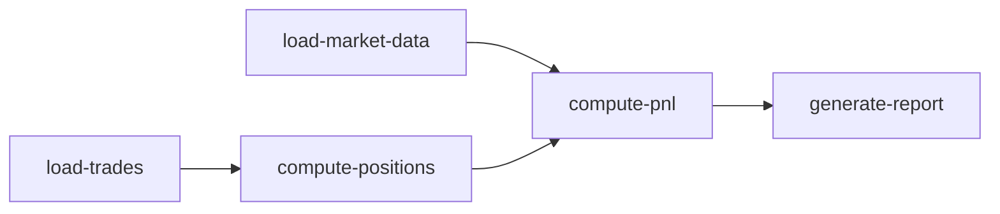
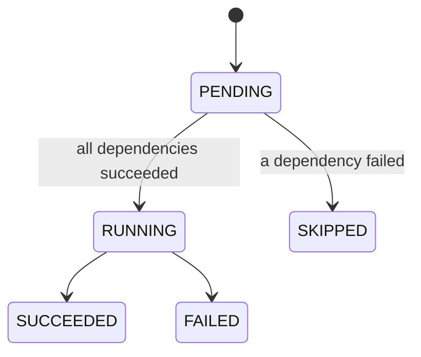

# EODFlow

> A Java / Spring Boot engine that runs a trading portfolio's **end-of-day (EOD) processing** as a **dependency graph of jobs**: load trades and prices → compute positions → compute P&L → report. Independent jobs run **in parallel**, and when a job fails, the jobs that depend on it are skipped.


**Status:** 🚧 In active development.

---

## Why this project

Every evening, banks run an end-of-day batch on their trading books: load closing prices, revalue positions, compute the day's profit and loss, and produce reports. These steps **depend on each other**. P&L can't run before positions are known, but loading trades and loading prices can happen at the same time.

EODFlow is a small version of that process, built to practise:

- **Workflow orchestration**: jobs with dependencies (a DAG), cycle detection, topological ordering
- **Java concurrency**: running independent jobs in parallel on a thread pool, with failure propagation
- **Financial calculations**: positions, mark-to-market and daily P&L with `BigDecimal`
- **Clean engineering**: layered design, JUnit 5 tests, REST API, GitHub Actions CI

## The EOD workflow



`load-trades` and `load-market-data` run **in parallel**. If a job fails, every job that depends on it is marked **SKIPPED**, while independent jobs keep running.

## Job lifecycle



## Tech stack

| Area | Technology |
|---|---|
| Language | Java 21 |
| Framework | Spring Boot 4 (Web, Validation) |
| Concurrency | `ExecutorService`, `AtomicInteger`, `ConcurrentHashMap`, `CountDownLatch` |
| Tests | JUnit 5, MockMvc |
| Build & CI | Maven, GitHub Actions |

## Architecture

```
api       →  REST controllers: start a run, read its status and report
eod       →  the business jobs (load trades, load prices, positions, P&L, report)
workflow  →  generic engine: Job, JobGraph (DAG), Sequential/ParallelRunner
domain    →  Trade, MarketPrice, position / valuation / P&L calculators (pure Java)
```

The **workflow engine knows nothing about finance**, and the **finance code knows nothing about the engine**. Each is tested on its own.


## Run it locally

Prerequisite: Java 21.

```bash
./mvnw spring-boot:run

# Start an end-of-day run
curl -X POST http://localhost:8080/api/runs \
     -H "Content-Type: application/json" \
     -d '{"businessDate":"2026-10-13"}'

# See the run and each job's status
curl http://localhost:8080/api/runs/1

# See the P&L report
curl http://localhost:8080/api/runs/1/report
```

Run the tests: `./mvnw verify`

## Results

_Filled in after the timing test: sequential vs parallel run time.

## Roadmap

- [ ] Project set up, CI green
- [ ] Finance domain: positions, valuation, P&L (unit-tested)
- [ ] Workflow engine: job graph, cycle detection, topological order
- [ ] Parallel execution with failure propagation
- [ ] EOD jobs wired together on generated data
- [ ] REST API
- [ ] Timing test: sequential vs parallel

## Author

**Larissa Abboud**, final-year MIAGE master's student, Université Toulouse Capitole
[LinkedIn](https://www.linkedin.com/in/larissa-abboud/) · [GitHub](https://github.com/larissa-abboud)
