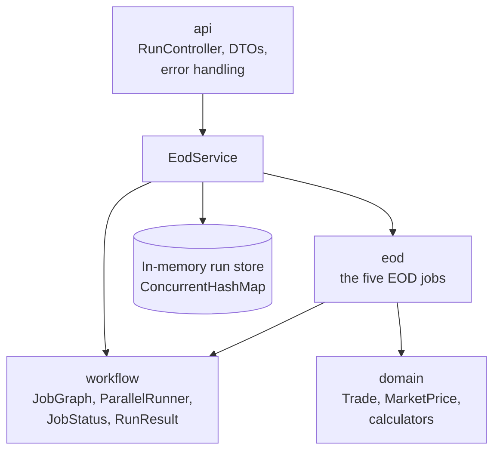
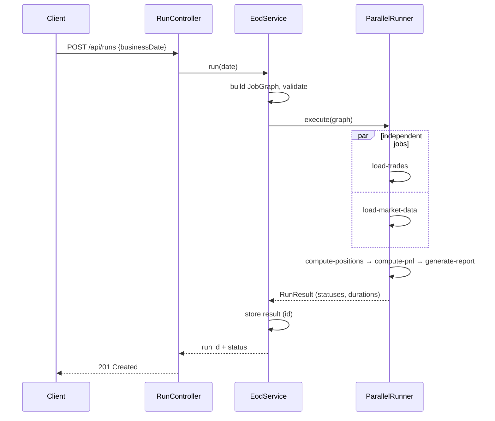

# Architecture

## Overview

EODFlow is a single Spring Boot application split into four packages with **one-way dependencies**. The finance code and the workflow engine are plain Java, so they can be unit-tested without starting Spring.

| Package | Responsibility | Depends on |
|---|---|---|
| `api` | HTTP, input validation, errors | `EodService` |
| `eod` | Concrete jobs that call the finance calculators | workflow, domain |
| `workflow` | Generic engine: graph validation, ordering, parallel execution | nothing (pure Java) |
| `domain` | Financial model and calculations | nothing (pure Java) |

## Domain

_Complete in Phase 1._

- `Trade(id, portfolio, instrument, side, quantity, price, tradeDate)`
- `MarketPrice(instrument, date, closePrice)`
- `PositionCalculator`: net quantity per instrument (BUY +, SELL −)
- `ValuationCalculator`: quantity × close price
- `PnlCalculator`: position × (today's close − yesterday's close)

## Workflow engine

_Complete in Phases 2–3._

- **JobGraph**: jobs + dependencies; `validate()` rejects unknown dependencies and cycles.
- **Ordering**: Kahn's algorithm gives a topological order.
- **ParallelRunner**: each job has a counter of unfinished dependencies (`AtomicInteger`). Jobs at 0 are submitted to a fixed thread pool; when a job succeeds, its children's counters are decremented. A `CountDownLatch` waits for the whole run.
- **Failures**: a failed job marks all its descendants SKIPPED; other branches continue.
- **JobContext**: `ConcurrentHashMap` used by jobs to pass results to each other.

## A run, step by step

## Key decisions

See [adr/](adr/).
